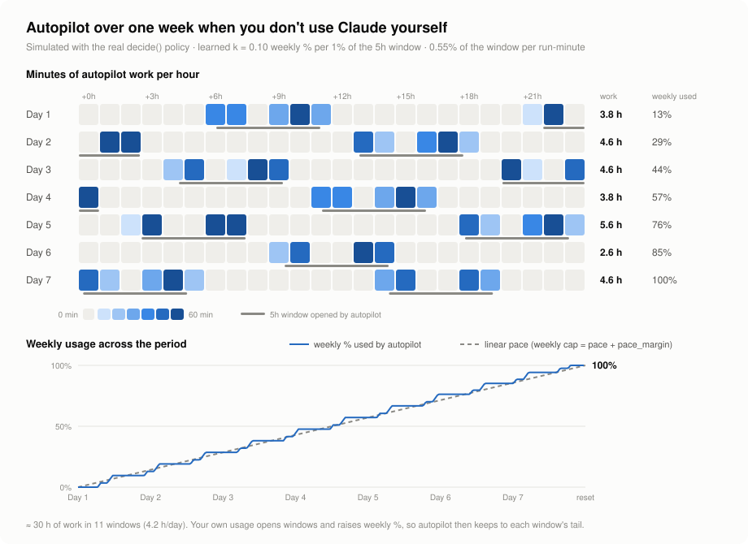

# claude-autopilot

Cron job that spends leftover Claude Code budget on roadmap work: each tick reads usage, decides whether to run, picks a project and runs `claude -p` in a git worktree.

- `autopilot.py` – the tick · `analyze.py` – stats · `schedule_chart.py` – redraws the chart below · `prompts/` – run prompts
- `config.example.json` → copy to `config.json` (gitignored) and edit. Also local: `reports/`, `logs/`, `worktrees/`, `state.json`, `*.jsonl`, `PAUSE`

## Setup
1. **Requirements**: Linux/macOS with cron, Python 3.9+ (stdlib only), `git`, [GitHub CLI](https://cli.github.com) logged in (`gh auth login`), and [Claude Code](https://docs.claude.com/en/docs/claude-code) logged in with a Pro/Max subscription (`claude` → `/login`; usage is read from `~/.claude/.credentials.json`, an API key does not work).
2. **Projects**: each project is a git clone at `<projects_dir>/<name>` whose `origin` is on GitHub, with a roadmap (`ROADMAP.md` by default) on its default branch. Runs use `claude --dangerously-skip-permissions` inside a worktree, so only list repos you trust it to edit.
3. **Config**: copy the example and edit it:

       cp config.example.json config.json

   - `projects`: replace `my-project` / `another-project` with your projects, highest priority first. Each name must be the **exact folder name** under `projects_dir`.
   - `projects_dir`: folder that holds those clones (default `~/projects`).
   - `project_opts`: delete the `another-project` example, or rename its key to one of your projects (keys must match names in `projects`).
   - `notify_telegram`: set `false` unless a Claude Code Telegram channel is set up (`~/.claude/channels/telegram/`).
4. **Check** it: `mkdir -p logs && python3 autopilot.py --dry-run` should print a decision without errors.
5. **Cron**: `crontab -e` and add (replace `/path/to`):

       */10 * * * * PATH=$HOME/.local/bin:/usr/local/bin:/usr/bin:/bin HOME=$HOME flock -n /path/to/claude-autopilot/lock python3 /path/to/claude-autopilot/autopilot.py >> /path/to/claude-autopilot/logs/tick.log 2>&1

   `PATH` must include the folders holding `claude` and `gh` (check with `which claude gh`).

Other commands:

    python3 autopilot.py --simulate "u5=60 r5=20 u7=10 r7=96" --dry-run
    python3 autopilot.py --force --project my-project --mode implement
    python3 autopilot.py --unblock my-project           # release a BLOCKED park
    touch PAUSE                                         # disable (rm to resume)

## Claude usage limits
Two limits apply at once:
- **5h window** (`u5`): starts with the first message sent while no window is open and lasts 5 hours, then resets to 0. Windows are not fixed slots: nothing runs until someone (you or autopilot) sends a message.
- **Weekly** (`u7`): one budget per 7 days, reset at a fixed time. Each 5h window spends only part of it (`k` = weekly % per 1% of a window, learned from `usage-log.jsonl`).

## When it runs

Simulated week with no manual usage (one setup, k = 0.10, work always available; redraw for yours with `python3 schedule_chart.py`). Autopilot opens a window only when the weekly total falls behind the linear pace line, so after a reset it waits a few hours, then opens one about every 15 h and works ~4 h a day. When you use Claude, your messages open the windows and autopilot only takes their tail.

- **TAIL** (default): start only in the last minutes of a window. Tail = `max(tail_minutes, fill*ramp_gain*300)`, where `fill = (100-u7) / windows_left / (k*100)` is the share of each remaining window needed to reach 100% weekly, so a week left unused ramps up early.
- **SATURATE** (tail ≥ 5h): weekly is far behind; run any time and open windows.
- **Open a window** only if `fill >= open_window_fill` and `u7` is below pace.
- **Weekly cap**: never above linear pace + `pace_margin`. **Intra-window pace line**: `u5` stays ≤ `100*elapsed_share + u5_pace_margin`, so the rest of the window stays free for you (SATURATE exempt).
- **BURN** (`"burn": true` or `--burn`): spend as fast as possible until `max_u5`/`max_u7`; no headroom left for you.
- Runs go back-to-back within a tick (`max_runs_per_tick`), re-reading usage after each. No new step starts with less than `min_step_minutes` (30) left.

## What it works on
Per project, in config priority order:
1. Open `autopilot/*` PR → review + fix until clean (`CLEAN`), then the driver merges it (CI gate).
2. Else implement the next roadmap step **in full** (a whole section/phase, never a partial PR), one branch + PR per step (`autopilot/<MMDD>-<session6>-<slug>`). Unfinished → `INCOMPLETE`, resumed next run.
3. Roadmap exhausted → author 3-6 new steps from deferred items, issues and ideas. Low review findings become `autopilot-followup` issues, folded into later steps or into sweep steps (4-12 issues each).

Rules:
- **Trust**: only PRs by the `gh` user from same-repo branches (or the user's fork for `push_remote`) are reviewed/merged; roadmap mode reads only `@me` issues.
- **Blocked**: a `BLOCKED` run parks the project until its roadmap file changes or `--unblock`.
- **Streak**: after `streak_limit` (5) PRs in one project, it is skipped for new work until another project opens a PR.
- **Starved roadmaps**: a project with no pending step and no roadmap run for `starved_roadmap_days` (3) gets one ahead of others.
- **Per-project options** (`project_opts`): `roadmap` path; `push_remote` (work from a fork, cross-repo PRs, no upstream issues); `merge: false` (stop at `READY`); `author_roadmap: false`; `depends_on` + `context` (this repo's work needs another project first: files `autopilot-dependency` issues there and waits on them).

## CI gate
Reviews never wait for CI. On `CLEAN`, the driver checks the PR every tick with `gh` (no tokens):
- green (or no checks after `ci_settle_minutes`) → squash-merge (`merge: false` → `READY`)
- red → Haiku summarises the failed logs and the PR goes back to review; red only on jobs also failing on the default branch → wait
- pending after `ci_timeout_minutes` (30) or merge conflict → back to review
- default branch red for `main_red_fix_hours` (2) → next implement run fixes it first

## Resume
Each run has a known session id. A run cut off (time/usage limit, crash) or ending `INCOMPLETE` is resumed with `claude --resume` in the same worktree, up to `max_resumes` times within `resume_max_hours`.

## Models
`model` (sonnet) for runs; `model_by_mode` puts roadmap authoring and self-review on opus. `helper_model` (haiku) does one-shot helpers with Python fallbacks: CI log summaries, Telegram digests, and a precheck that skips implement runs when no roadmap step is pending (`"precheck": false` to disable).

## Telemetry, self-review, pruning
- `runs.jsonl` (one row per run), `usage-log.jsonl` (one row per tick with the decision). `python3 analyze.py [--days 7]` summarises them.
- Every `selfreview_days` (7) an Opus self-review runs. It may change at most 3 numeric config keys within `BOUNDS`; other edits are reverted and ideas go to `reports/<date>-selfreview.md`.
- After a self-review, logs older than `log_keep_days` (14) and data older than `data_keep_days` (90) are pruned (`--prune [--dry-run]` by hand).
- Telegram: urgent events at once, routine ones batched every `digest_minutes` (60).
